# FORGE

Программа для технолога кузнечно-штамповочного цеха. Вводите деталь (размеры, сталь,
сколько штук в год) и получаете расчёт поковки по ГОСТ, технологический маршрут и две
заполненные карты по ЕСТД, которые можно сразу печатать или сохранить в PDF и Excel.
Маршрут строит локальная нейросеть или набор правил, все числа считает сама программа.

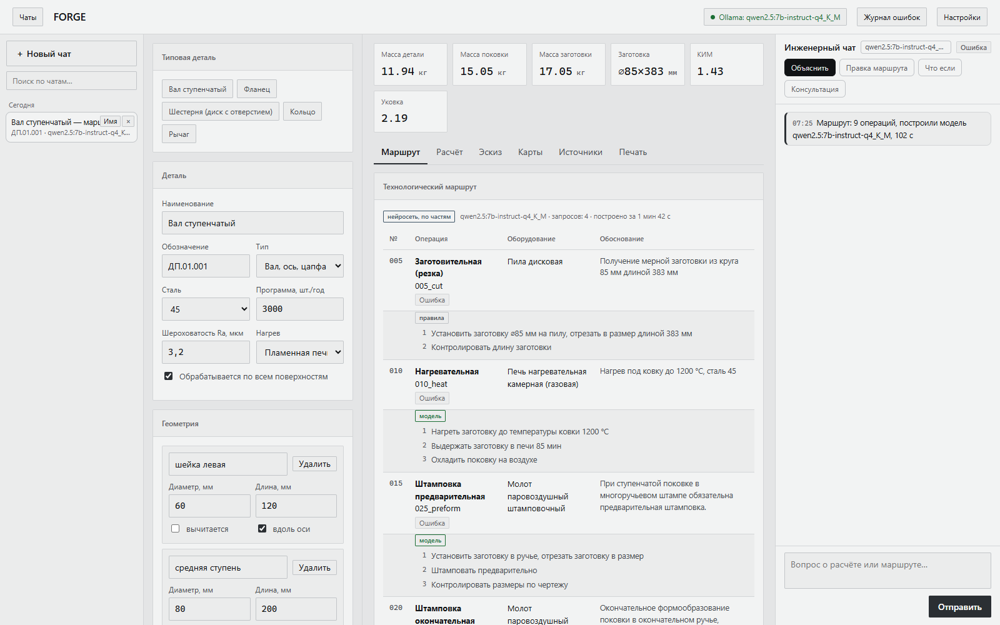

Совсем подробная инструкция, где разобрано каждое поле и каждое сообщение об ошибке,
лежит в [manual.txt](manual.txt). Этот README короче, но с картинками.

## Содержание

- [Что умеет](#что-умеет)
- [Как запустить](#как-запустить)
- [Первый запуск](#первый-запуск)
- [Как устроено окно](#как-устроено-окно)
- [Пример: ступенчатый вал за пять минут](#пример-ступенчатый-вал-за-пять-минут)
- [Как описать свою деталь](#как-описать-свою-деталь)
- [Кто строит маршрут: правила или нейросеть](#кто-строит-маршрут-правила-или-нейросеть)
- [Что получается на выходе](#что-получается-на-выходе)
- [Печать, PDF и Excel](#печать-pdf-и-excel)
- [Инженерный чат](#инженерный-чат)
- [Журнал ошибок модели](#журнал-ошибок-модели)
- [Нейросеть: как поставить](#нейросеть-как-поставить)
- [Три вида экрана](#три-вида-экрана)
- [Обновления](#обновления)
- [Если что-то не работает](#если-что-то-не-работает)
- [Как это устроено внутри](#как-это-устроено-внутри)
- [Запуск из исходников и структура репозитория](#запуск-из-исходников-и-структура-репозитория)
- [Ограничения](#ограничения)

## Что умеет

- Считает поковку: припуски, допуски, размеры и массу по ГОСТ 7505-89 (штамповка)
  или ГОСТ 7829-70 (свободная ковка).
- Выбирает вид техпроцесса по программе выпуска и массе: свободная ковка, штамповка
  на молоте, штамповка на кривошипном прессе (КГШП).
- Подбирает заготовку из сортамента ГОСТ 2590-2006, считает облой, угар, потери на резку
  и уковку.
- Назначает нагрев, интервал ковки, выдержки и термообработку по марке стали.
- Подбирает конкретную машину: молот по массе падающих частей, КГШП, ГКМ или гидравлический
  пресс по усилию, обрезной пресс.
- Строит маршрут с обоснованием каждой операции и раскрывает переходы внутри операций.
- Заполняет маршрутную карту по ГОСТ 3.1118-82 и карту техпроцесса ковки и штамповки
  по ГОСТ 3.1403-85, с основной надписью по ГОСТ 3.1103-82.
- Отвечает на вопросы по расчёту в инженерном чате, правит маршрут словами, пересчитывает
  варианты «а если сталь другая».
- Запоминает ошибки нейросети, которые отметил технолог, и в следующий раз подсказывает
  ей правильный ответ.

Все расчёты и нейросеть работают на вашем компьютере. Интернет нужен, только чтобы скачать
программу, модель и проверить обновления.

## Как запустить

Нужны Windows 10 или 11 и браузер Edge или Chrome (Edge есть в любой Windows 10/11).
Python и Ollama для готовой программы не нужны.

1. Скачайте `FORGE.exe` из [последнего релиза](https://github.com/WiWaSu/forge/releases/latest),
   блок Assets, около 10 МБ.
2. Положите его в отдельную папку, например `Документы\FORGE`. Рядом с ним программа
   создаст свои файлы: настройки, историю, выгрузки.
3. Запустите двойным щелчком. Если Windows покажет синее окно «Windows защитила ваш
   компьютер», нажмите «Подробнее» и «Выполнить в любом случае». Так Windows реагирует
   на любую программу без платной цифровой подписи.
4. Через несколько секунд откроется окно FORGE.

Выйти: закрыть окно крестиком, программа выключится сама.

## Первый запуск

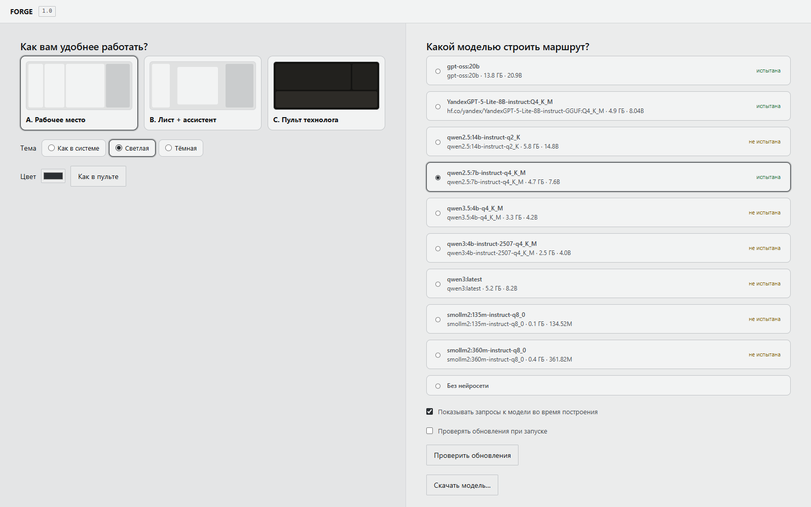

При первом запуске FORGE спрашивает, как вам удобнее работать:

- вид экрана A, B или C. Для начала берите «A. Рабочее место», в нём всё видно сразу;
- тема: как в системе, светлая или тёмная;
- цвет кнопок и выделения, любой. «Как в пульте» возвращает исходный серый;
- модель, которой строить маршрут. Пока Ollama не стоит, список пустой и выбрано
  «Без нейросети». Так тоже можно работать: маршрут построят правила.

Нажмите «Начать работу». Всё это потом меняется кнопкой «Настройки» в правом верхнем углу.

## Как устроено окно

В виде A четыре колонки, слева направо:

| Колонка | Что в ней |
|---|---|
| История | все прошлые расчёты, поиск по ним, «+ Новый чат» |
| Форма детали | типовые детали, данные детали, геометрия, выбор режима и кнопки «Построить маршрут» и «Только расчёт» |
| Результат | шесть плиток с главными числами и вкладки «Маршрут», «Расчёт», «Эскиз», «Карты», «Источники», «Печать» |
| Инженерный чат | вопросы к модели о расчёте, правка маршрута, «что если» |

В шапке: плашка состояния нейросети (зелёная, если всё готово; щелчок по жёлтой открывает
установку), «Журнал ошибок», «Настройки» и кнопка «Обновить до …», когда вышла новая версия.

## Пример: ступенчатый вал за пять минут

Пример работает и без нейросети. Повторите его один раз, и дальше всё будет понятно.

1. В блоке «Типовая деталь» нажмите «Вал ступенчатый». Форма заполнится: сталь 45,
   3000 шт./год, шероховатость Ra 3,2, три цилиндра ⌀60×120, ⌀80×200, ⌀50×90.
2. В блоке «Кто строит маршрут» выберите «Правила» (или «По частям», если нейросеть стоит).
3. Поставьте галочку «Раскрыть переходы внутри операций».
4. Нажмите «Построить маршрут».

С правилами результат появится меньше чем за секунду. С нейросетью qwen2.5:7b на ноутбучной
RTX 4050 это заняло 1 минуту 42 секунды, и всё это время видно, что модель делает:

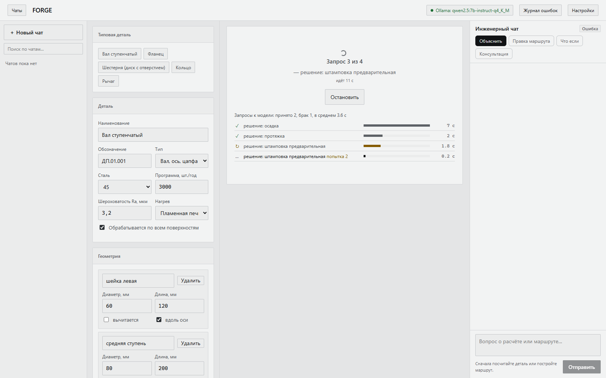

Каждая строка ленты это один вопрос модели: ✓ ответ принят, ↻ ответ не прошёл проверку
и модель переспросили, … идёт сейчас. Кнопка «Остановить» прерывает модель, недостающее
достроят правила.

Что получится:

| Что | Результат |
|---|---|
| Техпроцесс | горячая объёмная штамповка на молоте (3000 шт./год, серийное производство) |
| Поковка | 15,05 кг; группа стали М2, степень сложности С1, класс точности Т5, исходный индекс 16 |
| Размеры | например, средняя ступень ⌀80 получает припуск 4 мм, на поковке ⌀88 |
| Заготовка | круг ⌀85 по ГОСТ 2590-2006, длина 383 мм, 17,05 кг |
| Нагрев | 1200 °C, интервал ковки 1200–800 °C, камерная газовая печь |
| Оборудование | паровоздушный штамповочный молот 2500 кг, обрезной пресс 0,63 МН |
| Маршрут | 9–10 операций от резки до маркирования, с переходами |

Поменяйте программу на 10000 и постройте снова: молот сменится на КГШП 25 МН. Поставьте
100, и получится свободная ковка.

## Как описать свою деталь

Проще всего взять похожую типовую деталь и поправить размеры. Типовых пять: вал, фланец,
шестерня, кольцо, рычаг.

Данные детали: наименование (обязательно), обозначение по чертежу, тип детали, марка
стали из одиннадцати, программа выпуска в штуках за год, шероховатость Ra, вид нагрева
и галочка «обрабатывается по всем поверхностям». От программы зависит техпроцесс:

| Программа, шт./год | Техпроцесс |
|---|---|
| меньше 200 | свободная ковка, штамп не окупится |
| 200–4999 | штамповка на молоте в многоручьевом штампе |
| 5000 и больше | штамповка на КГШП |
| поковка тяжелее 100 кг | свободная ковка при любой программе |

Геометрия собирается из простых тел: цилиндр, труба, параллелепипед. Размеры в миллиметрах,
по чертежу детали, припуски FORGE добавит сам. У каждого тела две галочки:

- «вычитается»: тело вырезается, так задаются отверстия и выточки;
- «вдоль оси»: тело продолжает деталь по длине, как ступени вала. Без галочки тело
  стоит поперёк, как бобышка на рычаге.

| Деталь | Как её описать |
|---|---|
| Ступенчатый вал | три цилиндра подряд, все «вдоль оси» |
| Фланец | цилиндр ⌀200×25 и цилиндр ⌀80×25 «вычитается» |
| Шестерня | обод ⌀180×40, ступица ⌀90×30, отверстие ⌀45×70 «вычитается» |
| Кольцо | одна труба D 220, d 140, длина 50 |
| Рычаг | параллелепипед 220×60×30 и цилиндр ⌀70×40 без галочки «вдоль оси» |

Фаски, галтели и шпоночные пазы не вводите: в поковке их нет.

FORGE проверяет, похожа ли геометрия на выбранный тип, и объясняет, что не так:

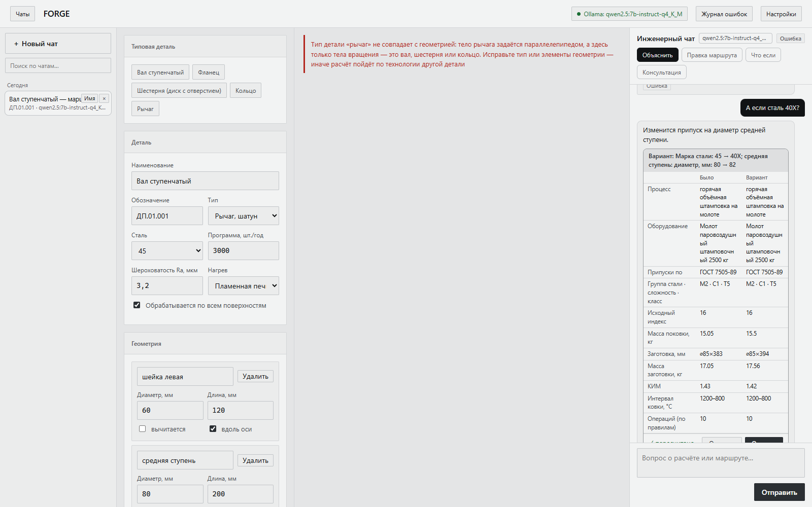

## Кто строит маршрут: правила или нейросеть

| Режим | Как работает | Когда брать |
|---|---|---|
| Правила | маршрут по справочнику, без нейросети, результат всегда одинаковый | Ollama нет, нужен быстрый ответ |
| Один запрос | модель пишет весь маршрут одним ответом | быстрее, ошибок больше |
| По частям | отдельный вопрос модели на каждое спорное решение: осадка, протяжка, предварительная штамповка, прошивка, правка, калибровка | по умолчанию, точнее |

Нейросеть решает, какие операции нужны и в каком порядке, и пишет обоснования. Числа она
не считает. Каждый её ответ FORGE проверяет: все ли обязательные операции на месте, нет ли
лишних, не нарушен ли порядок, не противоречит ли решение геометрии. Не прошёл проверку,
модель переспрашивают. Не помогло и это, место маршрута достраивают правила. В результате
у каждой операции метка, кто её поставил: «модель» или «правила».

## Что получается на выходе

Сверху шесть плиток: масса детали, поковки и заготовки, размер заготовки, КИМ и уковка.
Ниже вкладки.

### Маршрут

Операции по порядку с оборудованием и обоснованием, под каждой переходы.
Если строила модель, видно, сколько было запросов, сколько раз её переспрашивали и почему,
какие решения она приняла и чем её маршрут отличается от маршрута по правилам. У каждой
операции кнопка «Ошибка», чтобы записать промах модели.

### Расчёт

Всё по поковке: техпроцесс и почему выбран, группа стали, степень сложности,
класс точности, исходный индекс, таблица размеров с припусками и допусками, заготовка,
нагрев, оборудование и почему именно оно.

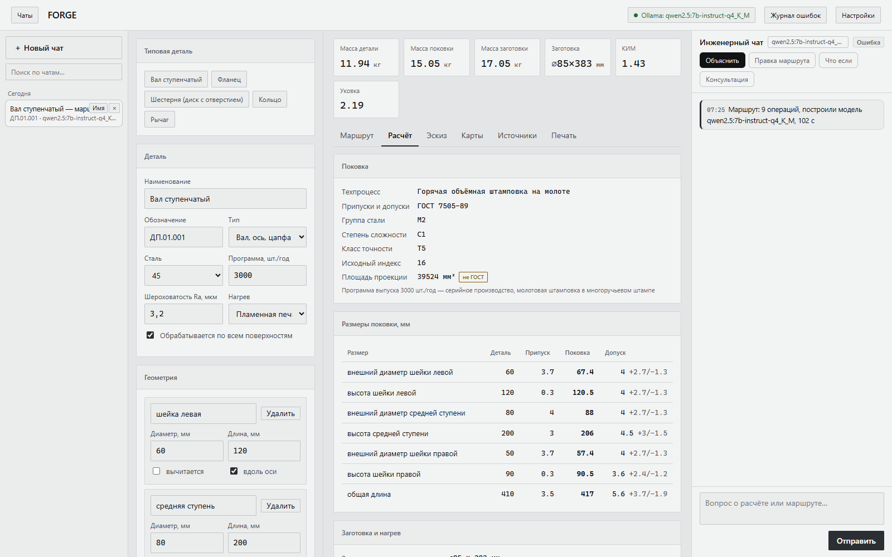

### Эскиз

Контур детали и поверх него контур поковки с размерами, плюс схема температуры
по операциям. Это схема для проверки на глаз, чертёж поковки FORGE не делает.

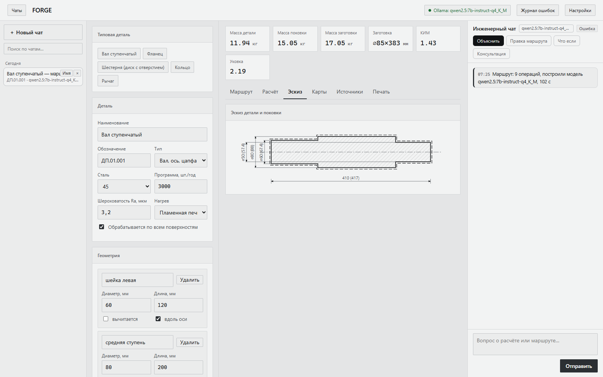

### Карты

Маршрутная карта (МК, ГОСТ 3.1118-82) и карта техпроцесса ковки и штамповки
(КТП, ГОСТ 3.1403-85) в том виде, в каком они печатаются. Графы подписей пустые.

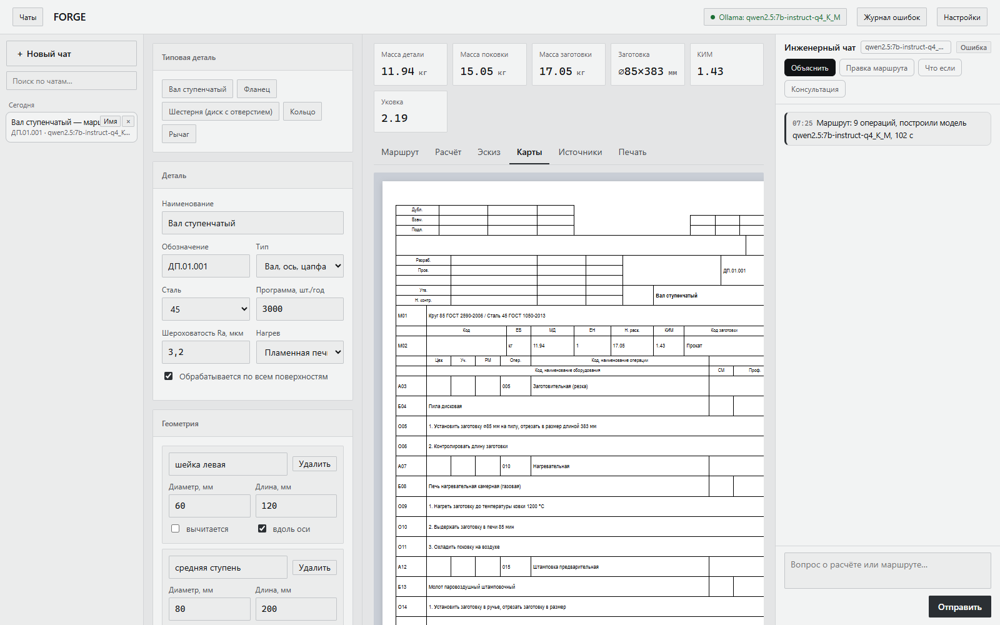

### Источники

Откуда взято каждое число. Сверху стандарты и что из каждого взято. Ниже
числа, которых в ГОСТ нет (потери металла, температуры, выдержки, усилия), с пометкой
происхождения: справочник, заводская норма, указание технолога, расчёт или «сверить»,
если это оценочная формула. Их стоит проверить перед подписью карты.

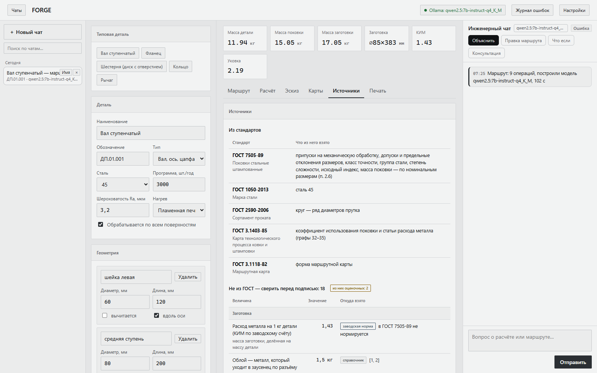

## Печать, PDF и Excel

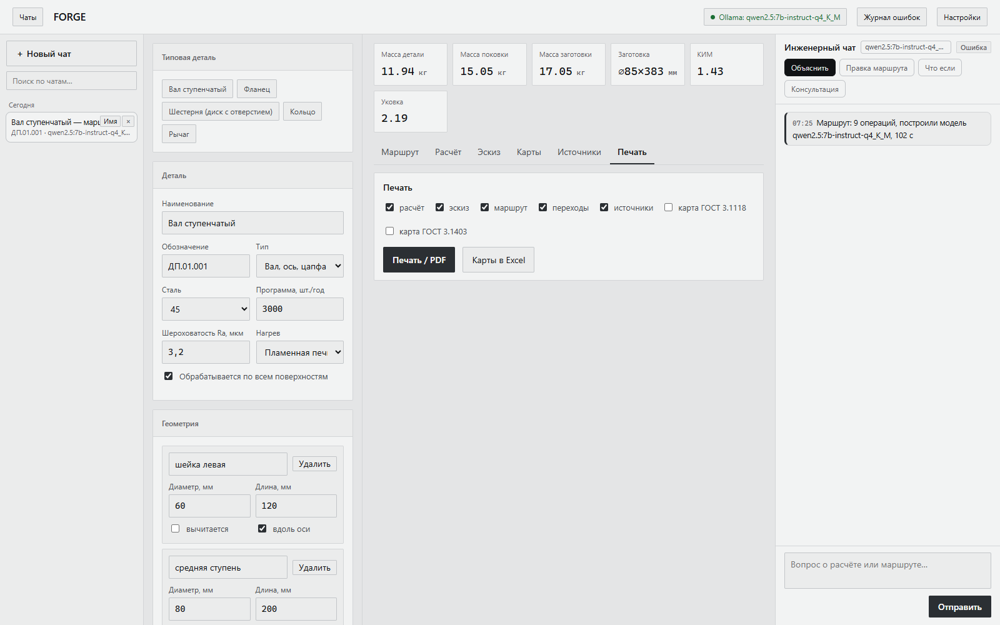

На вкладке «Печать» галочками выбираются разделы: расчёт, эскиз, маршрут, переходы,
источники, МК и КТП. «Печать / PDF» открывает окно печати браузера: выберите принтер или
«Сохранить как PDF». Рабочий лист печатается на А4, карты сами встают на альбомный А4.

«Карты в Excel» сохраняет обе карты в `.xlsx` в папку `exports` рядом с программой.

## Инженерный чат

Правая колонка. Спрашивает человек, отвечает модель, а числа в ответе FORGE сверяет
с расчётом. Под ответом пометка «числа сверены с расчётом» или список чисел, которых в
расчёте нет. Таким числам без проверки не верьте.

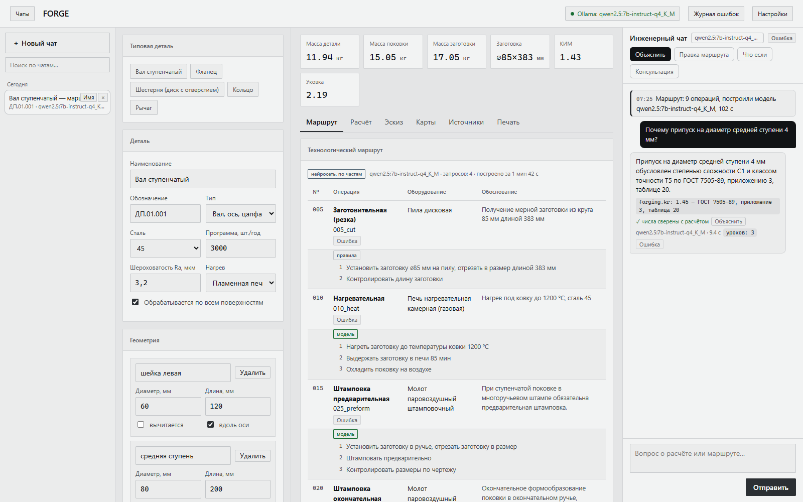

| Режим | Пример вопроса | Что происходит |
|---|---|---|
| Объяснить | «Почему припуск на средней ступени 4 мм?» | ответ по текущему расчёту и маршруту |
| Правка маршрута | «Убери правку» | FORGE применяет правку к копии маршрута, проверяет и показывает с кнопками «Принять» и «Отклонить» |
| Что если | «А если 10000 шт. в год?» | FORGE пересчитывает деталь сам и показывает таблицу «Было / Вариант» |
| Консультация | «Чем КГШП лучше молота?» | общий вопрос, ответ помечен «проверить по справочнику» |

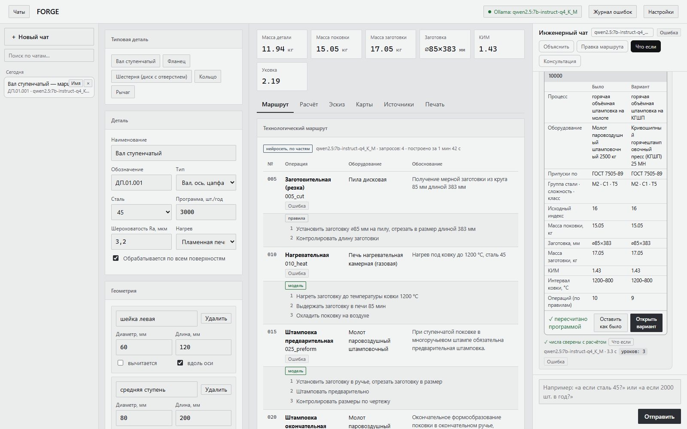

## Журнал ошибок модели

Если модель ошиблась, нажмите «Ошибка» у операции или под ответом и напишите, как правильно.
Например: «обрезку облоя ставят сразу после окончательной штамповки, до термообработки».

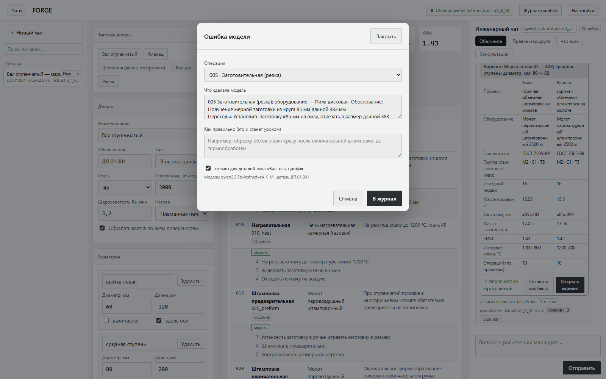

Запись попадает в «Журнал ошибок» на проверку. Когда технолог её примет, она станет уроком,
и модель будет получать его в каждом подходящем запросе. Переобучать модель для этого
не нужно. В журнале видно, сколько раз урок ушёл модели, повторялась ли ошибка после него
и какая модель ошибается чаще.

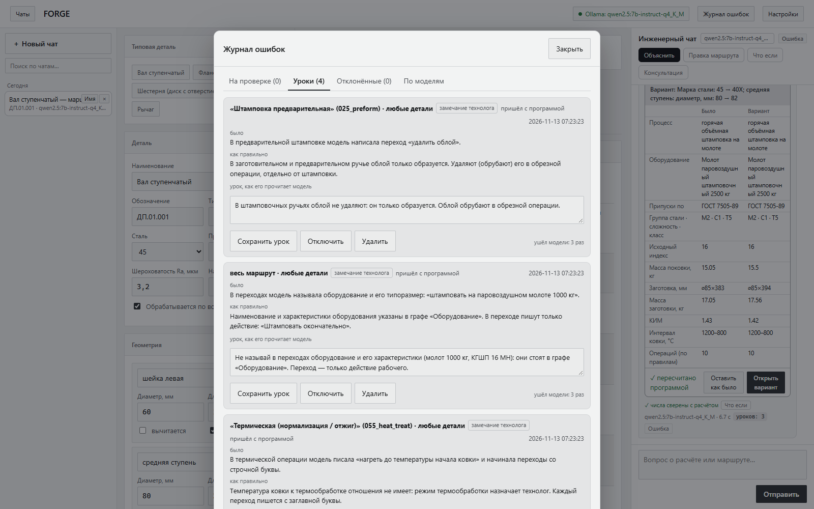

## Нейросеть: как поставить

Нужна бесплатная программа [Ollama](https://ollama.com) и модель. Ставится всё из FORGE:
щёлкните по жёлтой плашке Ollama в шапке или «Настройки» → «Скачать модель…».

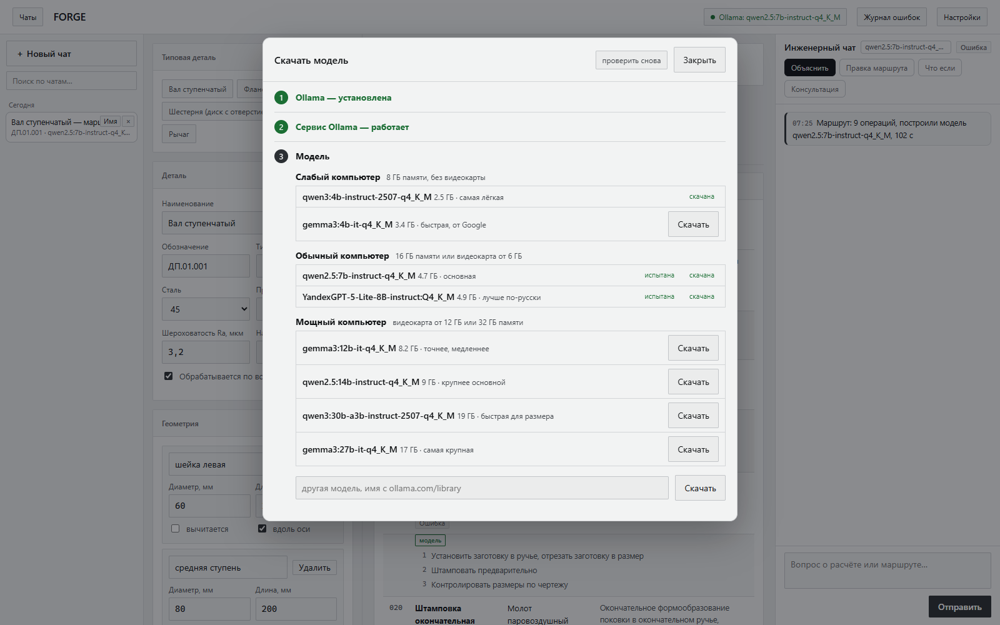

1. «Установить Ollama». Windows спросит права администратора.
2. «Запустить Ollama».
3. Выбрать модель и нажать «Скачать».

| Компьютер | Модели |
|---|---|
| Слабый: 8 ГБ памяти, без видеокарты | qwen3:4b (2,5 ГБ), gemma3:4b (3,4 ГБ) |
| Обычный: 16 ГБ памяти или видеокарта от 6 ГБ | qwen2.5:7b (4,7 ГБ, основная), YandexGPT-5-Lite-8B (4,9 ГБ) |
| Мощный: видеокарта от 12 ГБ или 32 ГБ памяти | gemma3:12b, qwen2.5:14b, qwen3:30b, gemma3:27b |

Метка «испытана» значит, что запросы настроены под эту модель и её прогоняли на типовых
деталях. Без нейросети FORGE работает полностью, кроме чата.

## Три вида экрана

Переключаются в «Настройках», данные и расчёт в них одни и те же.

### B. Лист + ассистент

Результат в виде бумажного листа, как он будет напечатан, и карты
на отдельных вкладках. Щелчок по строке листа задаёт вопрос о ней в чате. Форма детали
открывается кнопкой «Деталь».

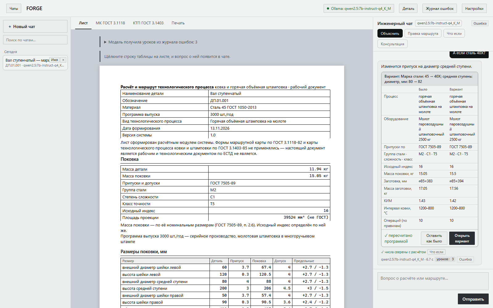

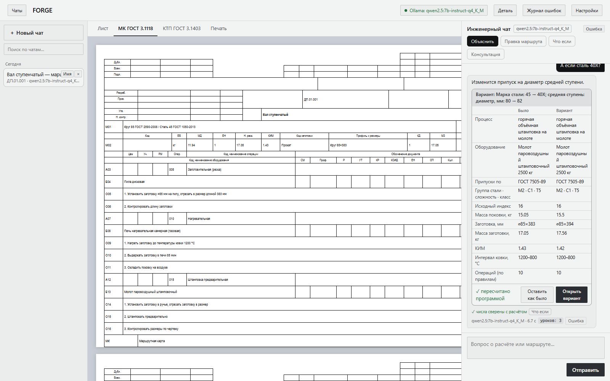

### C. Пульт технолога

Тёмный экран. Маршрут в виде цепочки карточек операций с графиком
температуры, горячие операции подчёркнуты. Щёлкните операцию, и справа будут её
оборудование, кто принял решение, обоснование и переходы.

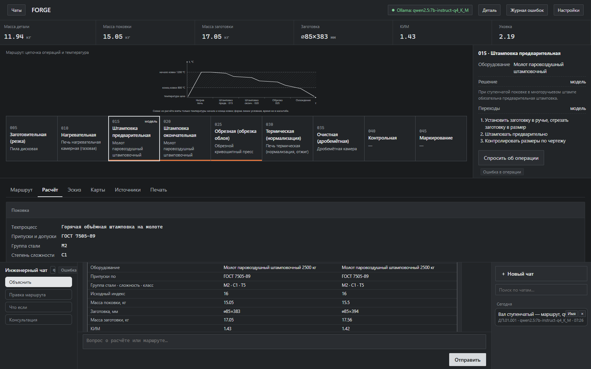

## Обновления

FORGE.exe при запуске проверяет, нет ли нового релиза в этом репозитории. Если есть,
в шапке появляется кнопка «Обновить до …». Нажали, и программа скачает новую версию,
закроется и откроется уже обновлённой. Настройки, история и журнал ошибок остаются.
Скачивает FORGE только с github.com и только программу Windows. Проверку можно выключить
в «Настройках».

## Если что-то не работает

| Что видно | Что делать |
|---|---|
| Синее окно «Windows защитила ваш компьютер» | «Подробнее» → «Выполнить в любом случае» |
| Красная плашка про тип и геометрию | в сообщении написано, что не так; поправьте тип или тела |
| «Не заполнено наименование детали» | впишите наименование |
| «Элемент 2 (цилиндр): нужны диаметр и длина» | у второго тела сверху пустое поле |
| Плашка «Ollama не запущена» | щёлкните по ней → «Запустить Ollama» |
| Плашка «Нет модели …» | скачайте модель или выберите другую в «Настройках» |
| Маршрут строится очень долго | возьмите модель полегче, режим «Один запрос» или «Правила» |
| «Откат на правила» | модель не дала годный ответ, маршрут построен по правилам; попробуйте другую модель |
| Чат серый | в «Настройках» выбрано «Без нейросети» или в форме выбраны «Правила» |
| «Движок не отвечает» | закройте окно и запустите FORGE снова |
| Окно не открылось | адрес программы записан в `forge.log` рядом с FORGE.exe, его можно открыть в браузере |

Полный список сообщений с объяснениями в [manual.txt](manual.txt), раздел 19.

## Как это устроено внутри

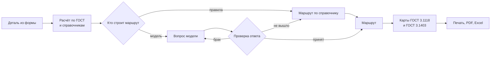

- Числа (массы, размеры, температуры, усилия) считает код по таблицам ГОСТ и справочникам.
  У каждого числа записан источник, значения не из ГОСТ помечены «не ГОСТ».
- Модель отвечает только за решения и текст. Её ответ разбирается как JSON и проверяется
  кодом: состав и порядок операций, обязательные операции, числа в тексте (каждое число
  должно найтись в расчёте).
- Модель работает через Ollama на этом же компьютере, запросы и ответы наружу не уходят.
- Интерфейс открывается в окне Edge или Chrome, за ним стоит локальный сервер на Python.

## Запуск из исходников и структура репозитория

Нужен Python 3.10 или новее. Сторонние пакеты не нужны: движок, сервер и тесты работают
на стандартной библиотеке.

```
serve.bat
```

| Файл | Что делает |
|---|---|
| `serve.bat` | запустить FORGE |
| `test.bat` | прогнать тесты (192 теста, меньше минуты) |
| `build.bat` | собрать `FORGE.exe` (нужен PyInstaller) |
| `forge.bat` | консольное меню: расчёт типовых деталей и проверка модели |

| Папка | Содержимое |
|---|---|
| `engine/calc` | расчёт: поковка, заготовка, нагрев, усилия, выбор оборудования |
| `engine/llm` | запросы к модели, проверка ответов, маршрут по правилам, переходы, чат |
| `engine/export` | карты по ГОСТ и выгрузка в Excel |
| `engine/api` | локальный сервер, с которым работает окно программы |
| `engine/tests` | тесты |
| `knowledge/reference` | справочные таблицы: ГОСТ 7505-89, ГОСТ 7829-70, стали, оборудование, формы карт |
| `instructions` | тексты запросов к модели и схема её ответа |
| `models` | профили испытанных моделей |
| `html` | интерфейс |

## Ограничения

- При свободной ковке оборудованием выбирается гидравлический пресс, а припуски идут
  по ГОСТ 7829-70, написанному для молотов. Подбор ковочного молота по массе ждёт источника.
- Деталь описывается цилиндрами, трубами и параллелепипедами, конусы и сферы приходится
  приближать.
- В справочнике одиннадцать марок стали: Ст3сп, 20, 35, 45, 40Х, 40ХН, 30ХГСА, 12ХН3А,
  У8А, ШХ15, 09Г2С.
- Модели на 4–8 млрд параметров иногда пишут неудачные переходы. Числа и обязательные
  операции FORGE проверяет, а формулировки переходов стоит прочитать глазами.
- КИМ на плитке и в графе 8 считается заводским способом, масса заготовки на массу детали,
  по указанию технолога. КИП по стандарту стоит в графе 32 карты техпроцесса.
